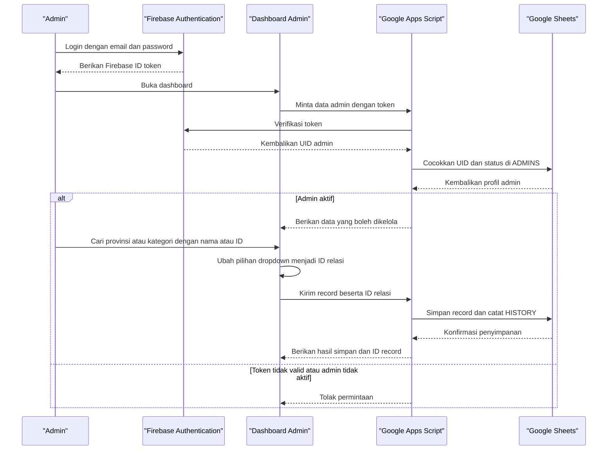

# Alur Input Data Admin

Dokumen ini menjelaskan urutan menyiapkan akun admin dan memasukkan data Jelajah Budaya Nusantara. Admin login melalui Firebase, sedangkan Google Sheets menjadi sumber data yang dibaca dan ditulis melalui Google Apps Script.

## Entitas Data

| Entitas | Sheet | Kegunaan dan hubungan |
|---|---|---|
| Admin | `ADMINS` | Memetakan UID Firebase ke profil, role, dan status akses admin. |
| Provinsi | `PROVINCES` | Data induk untuk budaya dan artikel. |
| Kategori | `CATEGORIES` | Data induk untuk budaya dan artikel. |
| Budaya | `CULTURES` | Konten budaya yang terhubung ke satu provinsi dan kategori. |
| Media | `MEDIA` | Tautan gambar, video, atau audio; dapat dihubungkan ke budaya. |
| Artikel | `ARTICLES` | Artikel yang dapat dihubungkan ke provinsi dan kategori. |
| Pengaturan | `SETTINGS` | Nilai pengaturan yang digunakan website. |
| Riwayat | `HISTORY` | Catatan simpan dan hapus yang dibuat backend. |

## Persiapan Awal

1. Aktifkan **Email/Password** di Firebase Authentication dan buat akun admin.
2. Jalankan `initializeDatabase()` di Apps Script untuk membuat sheet dan header jika belum tersedia.
3. Isi `ADMINS` dengan `admin_id`, `firebase_uid`, `username`, `name`, `email`, `role`, dan `status`. Admin harus memiliki status `ACTIVE`.
4. Deploy Apps Script sebagai Web App, lalu pastikan URL `/exec` di `shared/config.js` dapat diakses.
5. Login di dashboard menggunakan **email dan password Firebase**. Username pada sheet dipakai sebagai identitas admin, bukan sebagai kredensial login.

Password admin dikelola Firebase dan tidak dimasukkan ke spreadsheet. Sheet `ADMINS` tidak dikirim melalui API publik.

## Urutan Input Konten

Masuk ke dashboard admin, lalu masukkan data induk sebelum data yang bergantung padanya:

1. **Provinsi** — tambahkan provinsi terlebih dahulu. ID dibuat otomatis oleh backend saat record baru disimpan.
2. **Kategori** — tambahkan kategori yang akan dipakai untuk mengelompokkan budaya dan artikel.
3. **Budaya** — pilih provinsi dan kategori pada dropdown. Dropdown menampilkan nama serta ID; cari menggunakan nama atau ID. Saat disimpan, form mengirim ID relasi.
4. **Media** — isi jenis media dan URL. Hubungkan ke budaya melalui dropdown bila media terkait dengan satu budaya; relasi budaya boleh kosong. URL YouTube diputar melalui embed untuk jenis VIDEO maupun AUDIO. Untuk pemutar audio dengan durasi, gunakan URL file audio langsung seperti MP3, OGG, atau WAV; URL halaman YouTube bukan file audio langsung.
5. **Artikel** — pilih provinsi dan kategori melalui dropdown, lalu isi konten dan status.
6. **Pengaturan** — isi kunci dan nilai yang memang aman ditampilkan website.

Field ID utama untuk record baru tidak perlu diketik: backend membuat UUID. Setelah disimpan, ID dapat dilihat pada daftar record di dashboard dan pada sheet terkait.

## Relasi Antar Data

| Kolom relasi | Mengarah ke | Cara memilih |
|---|---|---|
| `CULTURES.province_id` | `PROVINCES.province_id` | Dropdown provinsi; cari nama atau ID. |
| `CULTURES.category_id` | `CATEGORIES.category_id` | Dropdown kategori; cari nama atau ID. |
| `MEDIA.culture_id` | `CULTURES.culture_id` | Dropdown budaya; boleh dikosongkan. |
| `ARTICLES.province_id` | `PROVINCES.province_id` | Dropdown provinsi; cari nama atau ID. |
| `ARTICLES.category_id` | `CATEGORIES.category_id` | Dropdown kategori; cari nama atau ID. |

Pilih opsi dari hasil dropdown agar form mengirim ID yang benar. Jika mengetik ID secara manual, ID itu harus cocok persis dengan ID record yang tersedia.

## Status dan Publikasi

- Provinsi, kategori, dan media menggunakan status `ACTIVE` atau `INACTIVE`.
- Budaya menggunakan status aktif/nonaktif dan pilihan publikasi. Budaya hanya tampil ke publik jika lolos aturan publikasi.
- Artikel berstatus `DRAFT` tidak tampil ke publik; gunakan `PUBLISHED` setelah siap.
- Media yang terhubung ke budaya hanya disertakan pada halaman publik jika budaya tersebut lolos aturan publikasi.
- Sheet `SETTINGS` dibaca oleh endpoint publik. Jangan menyimpan password, token, atau data rahasia di sana.

## Alur Simpan dan Hapus

Saat admin menyimpan record, dashboard memvalidasi pilihan relasi, lalu mengirim ID ke Apps Script. Backend membuat ID baru bila diperlukan, mengisi waktu pembuatan/perubahan, menyimpan record, dan mencatat aksi ke `HISTORY`. Saat record dihapus, backend menghapus baris record dan mencatat aksi penghapusan.

Penghapusan tidak menghapus record yang merujuk ke ID tersebut. Sebelum menghapus provinsi, kategori, atau budaya, periksa dahulu data terkait agar tidak meninggalkan relasi yang tidak lagi menunjuk ke record yang ada. Backend saat ini mengandalkan dropdown dashboard untuk pemilihan relasi dan belum memvalidasi keberadaan semua ID relasi di server.

## Pemetaan Layanan

| Layanan | Tanggung jawab |
|---|---|
| Firebase Authentication | Memverifikasi email/password dan menerbitkan ID token admin. |
| Dashboard admin | Menampilkan form, membantu pencarian nama/ID, dan mengirim pilihan sebagai ID. |
| Google Apps Script | Memverifikasi ID token, memeriksa status admin, serta menjalankan baca/simpan/hapus. |
| Google Sheets | Menyimpan data konten, pemetaan admin, dan riwayat perubahan. |
| Website publik | Membaca data yang lolos aturan status dan publikasi. |

## Alur Utama

<!-- mermaid-checked: every participant uses `participant Id as "Label"`, no \n in aliases/messages/notes, every alt/opt/loop closed by end, no `:` inside any alias -->

## Aturan Penting

- Semua operasi admin melalui Apps Script memerlukan Firebase ID token dan UID yang terdaftar aktif di `ADMINS`.
- Dashboard memetakan label dropdown kembali menjadi ID sebelum menyimpan.
- Record baru memperoleh UUID; record yang diperbarui mempertahankan ID-nya.
- Perubahan data admin pada sheet dibaca langsung saat permintaan admin berikutnya.
- Endpoint publik tidak menyertakan sheet `ADMINS` atau `HISTORY`.
